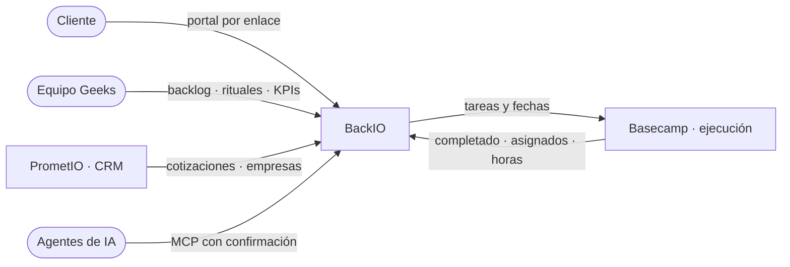

<div align="center">


# BackIO

**El backlog operativo de Geeks Ecuador.**<br />
Requerimientos, rituales de equipo y vista del cliente, sobre Basecamp como sistema de ejecución.

[](https://github.com/luispalaciosec/backIO/actions/workflows/ci.yml)
[](https://github.com/luispalaciosec/backIO/actions/workflows/deploy-frontend.yml)

[Aplicación](https://backio.vercel.app) · [Documentación](https://backio.vercel.app/docs) · [Arquitectura técnica](docs/17-arquitectura-tecnica.md) · [Decisiones](docs/decisiones.md)

</div>

---

BackIO reemplaza a Monday.com como tablero de requerimientos y como vista de cuenta para el cliente. El equipo sigue
ejecutando en Basecamp; BackIO organiza el trabajo, mide el cumplimiento y muestra al cliente solo lo que la agencia
decidió mostrar. En producción desde el 04/09/2026.



## Qué hace

| Para | Qué resuelve |
|---|---|
| **Ejecutivas de cuenta** | Backlog por cliente con filtros en la URL y edición en línea, bitácora, hoja de estatus, reprogramaciones con motivo y reprocesos |
| **Mesas de operación** | Daily por mesa con apertura y cierre publicados en Basecamp, weekly con motor de señales, Plan Operativo y Acta de Cierre |
| **Gerencia** | Dashboard, cumplimiento a fecha original y vigente, KPIs por persona y equipo, evolutivo de rituales e informes mensuales |
| **Clientes** | Portal por enlace (con PIN opcional) que muestra solo lo marcado como visible |
| **Agentes de IA** | API REST con scopes y servidor MCP donde toda escritura pasa por un plan que una persona confirma |

## Las reglas que no se rompen

1. **El texto de Basecamp no entra a BackIO.** Ni comentarios, ni descripciones, ni adjuntos: solo títulos, fechas,
   responsables, completado y horas. Es la garantía de que un comentario interno no llegue al cliente.
2. **La visibilidad para el cliente se hereda de la plantilla y nunca se abre.** Lo impide un trigger de la base.
3. **Un dueño por dato.** Basecamp manda sobre «completado»; BackIO, sobre todo lo demás.
4. **Un agente propone, una persona confirma.** Las tools de escritura del MCP devuelven un plan; no ejecutan.
5. **`tenant_id` y RLS en todas las tablas**, aunque hoy exista una sola organización.

Por qué existe cada una: [registro de decisiones](docs/decisiones.md). El mayor riesgo del sistema es que contenido
interno llegue al portal; las defensas están en [Qué ve el cliente](docs/02-visibilidad.md).

## Stack

| Capa | Tecnología |
|---|---|
| Datos y autenticación | Supabase: Postgres, RLS y Auth |
| Backend | Hono sobre Node 22, TypeScript estricto, zod · Railway |
| Frontend | Next.js 15 (App Router), React 19, Tailwind · Vercel |
| Integraciones | Basecamp 3 (OAuth2, webhooks, reconciliación) · PrometIO (webhook firmado) |
| IA | Claude, de Anthropic: redacta dailies, weeklies, briefs e informes; una persona publica |
| Operación | Logs JSON con niveles, Sentry sin datos personales, vigía de tareas programadas |

## Empezar

Requisitos: Node 20 o superior (producción usa 22) y pnpm 9.

```bash
pnpm install
cp backend/.env.example backend/.env          # Supabase, Basecamp, Anthropic, Resend…
cp frontend/.env.example frontend/.env.local
pnpm dev                                       # backend en :4000 · frontend en :3000
```

```bash
pnpm typecheck && pnpm lint && pnpm test       # lo mismo que corre el CI
pnpm --filter @backio/docs dev                 # documentación en local
```

Base de datos, usuarios y API keys: [Levantar el proyecto en local](docs/11-setup.md).

## Estructura

```
backend/    API Hono: routes/ (REST, portal, MCP, OAuth, webhooks) · lib/ (dominio, db, basecamp, ia, jobs)
            supabase/migrations/ (SQL numerado) · scripts/ (generadores y diagnóstico)
frontend/   Next.js: app/(app) área interna · app/p portal del cliente · components · lib
shared/     Tipos, fechas, métricas y la sanitización que decide qué llega al cliente
docs/       Sitio de documentación (VitePress), publicado en /docs
```

## Calidad y despliegue

- **CI en cada push** (GitHub Actions): auditoría de dependencias, tipos, lint con formato obligatorio, tests de
  backend, frontend y shared, build del frontend y de la documentación.
- **Despliegue:** Railway publica el backend con cada push a `main`. El frontend y la documentación se publican en
  Vercel cuando el CI termina en verde.
- **Migraciones:** archivos numerados en `backend/supabase/migrations/`, revisados antes de aplicarse. Después de cada
  una: `pnpm --filter @backio/backend db:types`.

Qué corre solo y qué hacer cuando algo falla: [Operación](docs/operacion.md).

## Documentación

Todo está en **[backio.vercel.app/docs](https://backio.vercel.app/docs)**. Para empezar: [Por dónde empezar](docs/empezar.md).

| Si vas a… | Lee |
|---|---|
| Entender el sistema | [Arquitectura](docs/00-arquitectura.md) · [Glosario](docs/glosario.md) |
| Tocar el portal o la sincronización | [Qué ve el cliente](docs/02-visibilidad.md) · [Basecamp](docs/04-basecamp.md) |
| Cambiar código | [Arquitectura técnica](docs/17-arquitectura-tecnica.md) · [`CLAUDE.md`](CLAUDE.md) |
| Integrar un sistema o un agente | [API y agentes](docs/07-api-mcp.md) · [Referencia de la API](docs/referencia-api.md) |
| Revisar la seguridad | [Seguridad](docs/18-seguridad.md) · [`HARDENING-CHANGELOG.md`](HARDENING-CHANGELOG.md) |

## Cómo contribuir

- Las zonas `lib/visibility/`, `lib/basecamp/write.ts`, las tools MCP de escritura y las políticas RLS no se cambian
  sin revisión humana ([`CLAUDE.md`](CLAUDE.md)).
- Si un cambio altera un comportamiento documentado, la página de `docs/` se corrige en el mismo commit.
- La documentación es pública: en `docs/` no van secretos, datos de clientes ni vulnerabilidades abiertas.

<div align="center">
<sub>BackIO · Geeks Ecuador · uso interno</sub>
</div>
