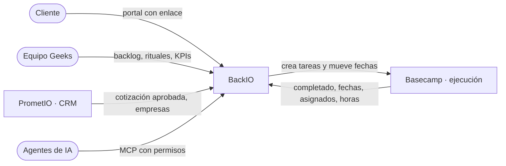

# Por dónde empezar

BackIO es la capa de gestión de cuenta y de backlog operativo de Geeks Ecuador. Reemplaza a Monday.com como tablero de
requerimientos y como vista del cliente, y se apoya en Basecamp, donde el equipo ejecuta el trabajo. Está en producción
desde el 04/09/2026.

Esta documentación está escrita para personas. Cada página dice qué hace una parte del sistema y por qué funciona así.
Si algo de lo que lees no coincide con lo que ves en BackIO, la página está desactualizada: avísalo o corrígela (los
archivos viven en `docs/` del repositorio).

## Según lo que vengas a hacer

| Si quieres… | Lee |
|---|---|
| Entender qué es BackIO y sus reglas | [Arquitectura y las cinco reglas](./00-arquitectura.md) |
| Saber qué ve un cliente y qué no | [Qué ve el cliente](./02-visibilidad.md) |
| Entender la relación con Basecamp | [Integración con Basecamp](./04-basecamp.md) |
| Entender el weekly, el daily y las señales | [Rituales](./05-rituales.md) |
| Saber cómo se calcula «a tiempo», un reproceso o un KPI | [Cumplimiento](./16-cumplimiento.md) y [KPIs](./19-kpis.md) |
| Resolver algo que no funciona | [Operar BackIO: cuando algo falla](./operacion.md) |
| Tocar el código por primera vez | [Levantar el proyecto en local](./11-setup.md) y luego [Arquitectura técnica](./17-arquitectura-tecnica.md) |
| Integrar otro sistema o un agente de IA | [API REST y agentes](./07-api-mcp.md) y la [referencia de la API](./referencia-api.md) |
| Saber por qué algo se decidió así | [Registro de decisiones](./decisiones.md) |
| Entender una palabra del dominio | [Glosario](./glosario.md) |

## El sistema en una imagen

- **BackIO manda** sobre el estado operativo, la aprobación, la prioridad y la fecha de entrega.
- **Basecamp manda** sobre si una tarea está completada. El texto de Basecamp (comentarios, descripciones) nunca entra
  a BackIO: es la garantía de que un comentario interno no llegue al cliente.
- El **cliente** solo ve lo que la plantilla marcó como visible, con su etiqueta para el cliente.

## Quién es quién

| Rol | Persona | Para qué |
|---|---|---|
| Product owner | Marcia (jefa de operaciones) | Decide el producto y los rituales |
| Administración técnica | Luis | Último recurso; credenciales, migraciones y despliegue |

## Cómo está organizada esta documentación

- **Cómo funciona BackIO:** el comportamiento del sistema, sin necesidad de leer código.
- **Operación:** lo necesario para mantenerlo andando.
- **Referencia técnica:** para quien cambia el código.
- **Decisiones:** el porqué de las reglas.
- **Historia:** planes y diseños originales. Sirven de contexto, pero no describen el sistema de hoy.
